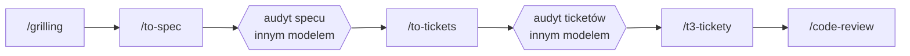

# t3-tickety

**Jeden agent robi tickety po kolei. Ten skill robi z niego kierownika zespołu.**

Masz kilka gotowych ticketów. `/t3-tickety` sprawdza, które nie wchodzą sobie w drogę, proponuje dla każdego osobnego agenta z dobranym modelem i effortem, rozsyła pracę do osobnych kopii repo, a potem scala wyniki, puszcza testy i sprząta po sobie. Ty podejmujesz jedną decyzję: kto robi co.

> **Rozszerzenie do paczki skilli Matta Pococka:** [mattpocock/skills](https://github.com/mattpocock/skills).
> Paczka Matta prowadzi od pomysłu do ticketów. Ten skill zaczyna tam, gdzie ona kończy: tickety są gotowe i trzeba je rozdać. Dodatek jest niezależny, nie należy do oficjalnej paczki i nie kopiuje z niej plików.

## Jak to wygląda

```text
Ty      /t3-tickety

Agent   Z 5 ticketów 3 mogą iść równolegle. 04 i 05 czekają na API z 01.

        01  Kontrakt API koszyka       Claude   mocny model    effort high
            ustala API dla 04 i 05, błąd tutaj kosztuje najwięcej
        02  Ekran pustego koszyka      Codex    szybki model   effort low
            jeden widok, zero zależności
        03  Eksport zamówień do CSV    Gemini   średni model   effort medium
            osobny moduł, nie dotyka plików 01 i 02

        Uruchomić tę konfigurację równolegle, robić po jednym tickecie
        czy zmienić dostawców, modele lub effort?

Ty      Uruchom.
```

To przykład. Lista dostawców i modeli zależy od tego, co masz podpięte w T3 Code, a agent czyta ją na żywo, zanim cokolwiek zaproponuje.

Po Twoim "uruchom" dzieje się reszta:

1. Każdy ticket dostaje własnego agenta i własny worktree (osobną kopię roboczą repo), więc agenci nie nadpisują sobie plików.
2. Gdy agent wraca, kierownik porównuje jego diff z kryteriami ticketu i scala commity pojedynczo do jednej gałęzi.
3. Na połączonym kodzie idzie build i testy. Jeśli coś pęka, worktree zostaje do diagnozy.
4. Po zielonych testach skill usuwa tylko te worktree, których praca jest już na gałęzi, i raportuje to, co zostało do wyjaśnienia.

## Po co dobierać wykonawcę do ticketu

- **Koszt.** Ekran z jednym przyciskiem nie potrzebuje najdroższego modelu na najwyższym efforcie.
- **Ryzyko.** Ticket, który ustala API dla trzech kolejnych, zasługuje na najmocniejszego wykonawcę, jakiego masz.
- **Czas.** Trzy niezależne tickety robią się naraz, a nie w kolejce.
- **Hamulec.** Równolegle idzie tylko to, co da się zaimplementować i przetestować osobno. Gdy jeden ticket ustala kontrakt dla drugiego, skill ustawia je po kolei.

## Cały flow: od pomysłu do scalonego kodu

Tak z tego korzystam. Kroki 1, 2, 4 i 6 to skille Matta, krok 5 to ten skill, a oba audyty robię innym modelem niż ten, który pisał.



| Krok | Co uruchamiam | Co z tego wychodzi |
| --- | --- | --- |
| 1 | `/grilling` | Wspólne zrozumienie, co budujemy |
| 2 | `/to-spec` | Spec zapisany w trackerze |
| 3 | Audyt specu innym modelem | Lista luk i poprawiony spec |
| 4 | `/to-tickets`, potem audyt ticketów | Tickety z zależnościami |
| 5 | `/t3-tickety` | Kod z każdego ticketu scalony na jednej gałęzi |
| 6 | `/code-review` | Przegląd całości przed mergem |

### 1. Grill: ustalam, co chcę zrobić

Uruchamiam `/grilling` i opisuję pomysł. Agent zadaje pytania rundami, do każdego daje swoją rekomendację, a fakty z kodu sprawdza sam. Kończymy, gdy nie zostaje żadna decyzja podjęta po cichu.

### 2. Spec: plan na bazie grilla

W tym samym wątku uruchamiam `/to-spec`. Skill nie pyta od nowa, tylko spisuje to, co ustaliliśmy: problem, rozwiązanie, historyjki użytkownika, decyzje implementacyjne, decyzje o testach i to, co jest poza zakresem.

### 3. Audyt specu innym modelem

Otwieram nowy wątek z modelem innym niż ten, który pisał spec. Jeśli spec pisał Claude, audytuje GPT albo Gemini, i odwrotnie.

Nowy wątek nie zna rozmowy z grilla, więc widzi tylko to, co naprawdę trafiło do pliku. Wszystko, co było oczywiste w rozmowie, ale nie zostało zapisane, wychodzi właśnie tutaj. Lepiej teraz niż u trzech agentów naraz.

Prompt na start:

```text
Przeczytaj spec w <ścieżka do specu>. Nie poprawiaj go. Wypisz:
1. Luki: decyzje, których brakuje, żeby zacząć implementację.
2. Sprzeczności między sekcjami.
3. Założenia o kodzie, które nie zgadzają się z repo. Sprawdź je w plikach.
4. Rzeczy, które powinny być poza zakresem, a są w środku.
Do każdego punktu podaj cytat ze specu i propozycję poprawki.
```

Uwagi wklejam autorowi specu i decyduję, które przyjmuję. Spec poprawia autor, nie audytor.

### 4. Tickety i audyt ticketów

Uruchamiam `/to-tickets`. Skill tnie spec na pionowe plastry: każdy ticket przechodzi przez wszystkie warstwy, da się go sprawdzić osobno i ma wpisane, które tickety go blokują.

Potem drugi audyt, znowu innym modelem w nowym wątku:

```text
Przeczytaj spec w <ścieżka do specu> i tickety w <katalog z ticketami>. Sprawdź:
1. Czy każda historyjka ze specu ma swój ticket.
2. Czy każdy ticket da się zrobić i przetestować bez pozostałych, poza tymi z "Blocked by".
3. Czy zależności są kompletne i nie tworzą pętli.
4. Które tickety dotykają tych samych plików, więc nie powinny iść równolegle.
Do każdej uwagi podaj numer ticketu i propozycję poprawki.
```

Punkt 4 jest tu najważniejszy, bo od niego zależy, co w następnym kroku pójdzie równolegle.

### 5. Implementacja: `/t3-tickety`

Najpierw tickety, potem implementacja. Na tym etapie są trzy drogi:

| Sytuacja | Czego użyć |
| --- | --- |
| Jeden ticket albo łańcuch, w którym każdy czeka na poprzedni | `/implement` Matta, po kolei w jednym wątku |
| Kilka niezależnych ticketów, ten sam agent i model do wszystkich | `/implement-spec` Matta, który rozdaje pracę swoim podagentom |
| Kilka niezależnych ticketów i chcesz sam dobrać wykonawcę do każdego | `/t3-tickety` |

### 6. Przegląd

Na scalonej gałęzi uruchamiam `/code-review`. Sprawdza dwie rzeczy naraz: czy kod trzyma standardy repo i czy robi to, co zapisano w specu.

## Instalacja

Jedna komenda dla wszystkich agentów w repo:

```bash
npx skills add Szewowsky/t3-tickety
```

Instalator zapyta, dla których agentów zainstalować. Żeby pominąć pytania:

```bash
npx skills add Szewowsky/t3-tickety -a claude-code -a codex -a gemini-cli -y
```

Skill to jeden plik `SKILL.md` w otwartym formacie, więc każdy agent czyta tę samą treść:

| Agent | Gdzie ląduje skill |
| --- | --- |
| Codex | `.agents/skills/t3-tickety/` |
| Gemini CLI | `.agents/skills/t3-tickety/` |
| Claude Code | `.claude/skills/t3-tickety`, dowiązanie do katalogu wyżej |
| Inny agent | `npx skills add Szewowsky/t3-tickety -a <agent>` albo ręczna kopia katalogu `skills/t3-tickety/` |

Po instalacji wywołujesz go jako `/t3-tickety` albo piszesz agentowi, że chcesz rozdać tickety w T3.

## Wymagania

- **T3 Code.** Skill korzysta z jego narzędzi `orchestrator_capabilities` (lista dostępnych dostawców i modeli) oraz `delegate_task` (zlecenie pracy agentowi w osobnym worktree). [T3 Code](https://github.com/pingdotgg/t3code) to aplikacja do sterowania Claude Code, Codex i innymi agentami z jednego miejsca. Skill działa u tego agenta, którego w niej uruchomisz, o ile ma dostęp do tych dwóch narzędzi.
- **Tickety z kryteriami odbioru.** U mnie robi je paczka Matta. Instalacja jest w [jego README](https://github.com/mattpocock/skills#installation-30-second-setup), w Claude Code to:

  ```bash
  claude plugin install mattpocock-skills@claude-plugins-official
  ```

  Potem raz w każdym repo uruchom `/setup-matt-pocock-skills`. Skill zapyta, gdzie trzymasz tickety: GitHub, lokalne pliki Markdown albo coś innego.
- **Repo w Git** z testami, które da się uruchomić jedną komendą.

## Pytania

**Czy to działa bez T3 Code?**
Nie. Bez `delegate_task` agent nie ma jak zlecić ticketu innemu dostawcy. W samym Claude Code albo Codex użyj `/implement-spec` Matta.

**Czy muszę mieć paczkę Matta?**
Skill potrzebuje ticketów, z których da się wyczytać kryteria odbioru i zależności. Był pisany pod format z `/to-tickets`, ale tickety z innego źródła też przejdą, jeśli mają te dwie rzeczy.

**Mogę dać wszystko jednemu dostawcy?**
Tak. Agent pokazuje propozycję, a Ty możesz zmienić dostawców, modele i effort albo wybrać pracę po jednym tickecie.

**Co, jeśli wybrany model jest niedostępny?**
Agent nie podmienia go po cichu. Pokazuje dostępne zamienniki i czeka na Twój wybór.

## Język

Skill jest napisany po polsku, więc agent prowadzi tę część pracy po polsku. Jeśli pracujesz po angielsku, przetłumacz `SKILL.md`. To pięć akapitów.

## Licencja

MIT, zobacz [LICENSE](LICENSE). Paczka [mattpocock/skills](https://github.com/mattpocock/skills) ma własną licencję MIT i własnego autora.
